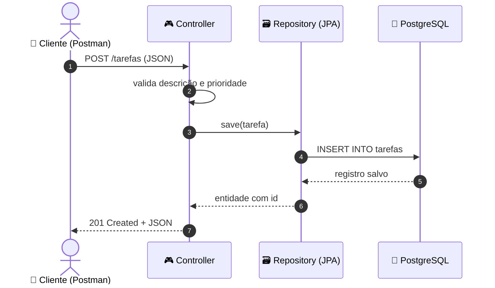
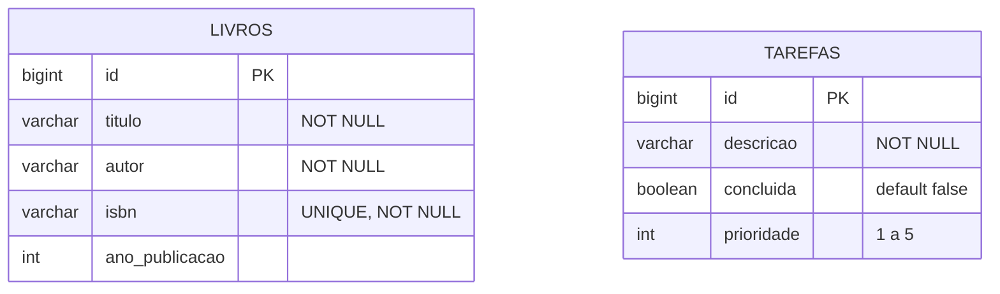
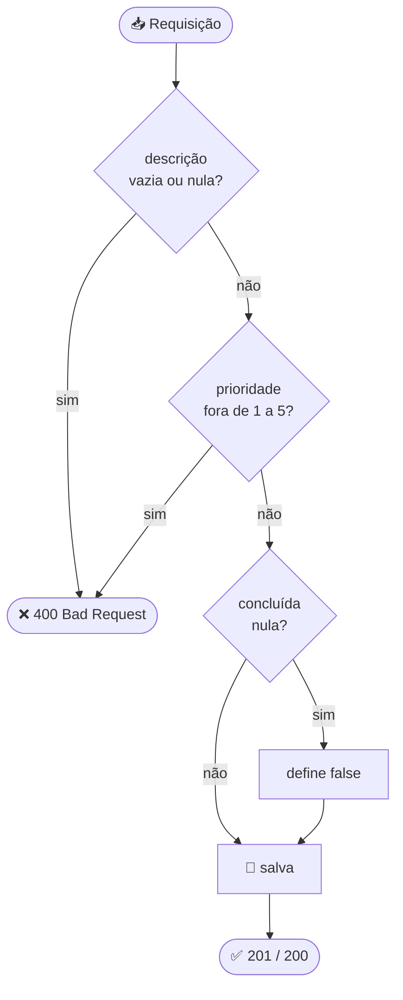

<div align="center">


<a href="https://git.io/typing-svg"></a>

<br/>


</div>

---

## 🧭 Índice

- [✨ Visão geral](#-visão-geral)
- [🏗️ Arquitetura](#️-arquitetura)
- [🗃️ Modelo de dados](#️-modelo-de-dados)
- [🚀 Como executar](#-como-executar)
- [📖 Desafio 1: Biblioteca](#-desafio-1-api-de-biblioteca)
- [✅ Desafio 2: Tarefas](#-desafio-2-api-de-tarefas)
- [🧪 Testes no Postman](#-testes-no-postman)
- [🗺️ Roadmap](#️-roadmap)
- [👤 Autor(a)](#-autora)

---

## ✨ Visão geral

Aplicação **Spring Boot** única que entrega **duas APIs REST independentes**, cada uma com seu pacote, entidade, repository e controller, compartilhando o mesmo banco **PostgreSQL**.

<table>
<tr>
<td width="50%" valign="top">

### 📖 Biblioteca
Gerencie livros com **ISBN único**.

`GET` `POST` `PUT` `DELETE`
**Rota:** `/livros`

</td>
<td width="50%" valign="top">

### ✅ Tarefas
Controle tarefas com **prioridade de 1 a 5** e status de conclusão.

`GET` `POST` `PUT` `DELETE`
**Rota:** `/tarefas`

</td>
</tr>
</table>

> [!NOTE]
> Cada desafio é isolado em seu próprio pacote, então dá pra evoluir um sem mexer no outro.

---

## 🏗️ Arquitetura



<details>
<summary>📁 <b>Estrutura de pastas</b></summary>

```
src/main/java/br/edu/fatecpg/tecprog/springweb/
├── 🚀 SpringwebApplication.java
├── 📖 biblioteca/
│   ├── model/Livro.java
│   ├── repository/LivroRepository.java
│   └── controller/LivroController.java
└── ✅ tarefa/
    ├── model/Tarefa.java
    ├── repository/TarefaRepository.java
    └── controller/TarefaController.java
```
</details>

---

## 🗃️ Modelo de dados



> [!TIP]
> As tabelas são criadas automaticamente pelo Hibernate (`ddl-auto=update`). Não precisa rodar nenhum script.

---

## 🚀 Como executar

### 📋 Pré-requisitos

| Ferramenta | Versão |
|---|---|
| ☕ JDK | 17 |
| 🐘 PostgreSQL | rodando na porta `5432` |
| 📦 Maven | ou use o `mvnw` incluso |

### ▶️ Passo a passo

**1️⃣ Clonar**
```bash
git clone https://github.com/SEU_USUARIO/SpringWeb.git
cd SpringWeb
```

**2️⃣ Criar o banco**
```sql
CREATE DATABASE db_springwebdesafios;
```

**3️⃣ Configurar** `src/main/resources/application.properties`
```properties
spring.application.name=springweb
server.port=8081

spring.datasource.url=jdbc:postgresql://localhost:5432/db_springwebdesafios
spring.datasource.username=postgres
spring.datasource.password=SUA_SENHA
spring.datasource.driver-class-name=org.postgresql.Driver

spring.jpa.hibernate.ddl-auto=update
```

**4️⃣ Rodar**
```bash
./mvnw spring-boot:run
```

🪟 No Windows: `mvnw.cmd spring-boot:run`, ou execute `SpringwebApplication` pela IDE.

> [!IMPORTANT]
> Depois de subir, a API responde em **`http://localhost:8081`**.

> [!WARNING]
> **"Port 8081 was already in use"?** Tem outra execução ativa. Finalize-a ou mude `server.port`.

---

## 📖 Desafio 1: API de Biblioteca

### 🧱 Entidade `Livro`

| Campo | Tipo | Regra |
|---|---|---|
| 🔑 `id` | `Long` | Chave primária, auto incremento |
| 📕 `titulo` | `String` | ❗ Obrigatório |
| ✍️ `autor` | `String` | ❗ Obrigatório |
| 🔢 `isbn` | `String` | ❗ Obrigatório e **único** |
| 📅 `anoPublicacao` | `Integer` | Opcional |

### 🔗 Endpoints

| Método | Rota | Descrição | Sucesso | Erro |
|:---:|---|---|:---:|:---:|
|  | `/livros` | Cadastra um livro | ✅ `201` | - |
|  | `/livros` | Lista todos | ✅ `200` | - |
|  | `/livros/{id}` | Busca por id | ✅ `200` | ❌ `404` |
|  | `/livros/{id}` | Atualiza | ✅ `200` | ❌ `404` |
|  | `/livros/{id}` | Remove | ✅ `204` | ❌ `404` |

<details>
<summary>📨 <b>Exemplo de requisição e resposta</b></summary>

**POST** `/livros`
```json
{
  "titulo": "Clean Code",
  "autor": "Robert C. Martin",
  "isbn": "9780132350884",
  "anoPublicacao": 2008
}
```

**Resposta** `201 Created`
```json
{
  "id": 1,
  "titulo": "Clean Code",
  "autor": "Robert C. Martin",
  "isbn": "9780132350884",
  "anoPublicacao": 2008
}
```
</details>

---

## ✅ Desafio 2: API de Tarefas

### 🧱 Entidade `Tarefa`

| Campo | Tipo | Regra |
|---|---|---|
| 🔑 `id` | `Long` | Chave primária, auto incremento |
| 📝 `descricao` | `String` | ❗ Obrigatória e não vazia |
| ☑️ `concluida` | `Boolean` | Padrão `false` |
| 🔥 `prioridade` | `Integer` | De **1 a 5** (opcional) |

### 🔗 Endpoints

| Método | Rota | Descrição | Sucesso | Erro |
|:---:|---|---|:---:|:---:|
|  | `/tarefas` | Cria uma tarefa | ✅ `201` | ❌ `400` |
|  | `/tarefas` | Lista todas | ✅ `200` | - |
|  | `/tarefas/{id}` | Busca por id | ✅ `200` | ❌ `404` |
|  | `/tarefas/{id}` | Atualiza / conclui | ✅ `200` | ❌ `400` `404` |
|  | `/tarefas/{id}` | Remove | ✅ `204` | ❌ `404` |

### 🛡️ Regras de validação



<details>
<summary>📨 <b>Exemplo de requisição</b></summary>

**POST** `/tarefas`
```json
{
  "descricao": "Estudar Spring Data JPA",
  "concluida": false,
  "prioridade": 4
}
```

**Resposta** `201 Created`
```json
{
  "id": 1,
  "descricao": "Estudar Spring Data JPA",
  "concluida": false,
  "prioridade": 4
}
```
</details>

---

## 🧪 Testes no Postman

> [!NOTE]
> Configure `Body` → `raw` → `JSON` e o header `Content-Type: application/json`.

<details>
<summary>📖 <b>Roteiro: Livros</b></summary>

| # | Teste | Requisição | Esperado |
|:---:|---|---|:---:|
| 1 | ➕ Criar | POST `/livros` | `201` |
| 2 | 📋 Listar | GET `/livros` | `200` |
| 3 | 🔍 Buscar | GET `/livros/1` | `200` |
| 4 | ✏️ Atualizar | PUT `/livros/1` | `200` |
| 5 | 🗑️ Deletar | DELETE `/livros/1` | `204` |
| 6 | 👻 Id inexistente | GET `/livros/999` | `404` |
</details>

<details>
<summary>✅ <b>Roteiro: Tarefas</b></summary>

| # | Teste | Requisição | Esperado |
|:---:|---|---|:---:|
| 1 | ➕ Criar | POST `/tarefas` | `201` |
| 2 | 📋 Listar | GET `/tarefas` | `200` |
| 3 | 🔍 Buscar | GET `/tarefas/1` | `200` |
| 4 | ☑️ Concluir | PUT `/tarefas/1` com `"concluida": true` | `200` |
| 5 | 🗑️ Deletar | DELETE `/tarefas/1` | `204` |
| 6 | 🔥 Prioridade 6 | POST com `"prioridade": 6` | `400` |
| 7 | 🚫 Sem descrição | POST `{"prioridade": 3}` | `400` |
| 8 | 👻 Id inexistente | GET `/tarefas/999` | `404` |
</details>

> [!WARNING]
> **Limitação conhecida:** na API de Livros, ISBN duplicado ou campo obrigatório nulo retorna `500` (violação de constraint no banco), pois ainda não há tratamento global de exceções.

---

## 🗺️ Roadmap

- [x] CRUD de Livros
- [x] CRUD de Tarefas
- [x] Validação manual de prioridade
- [ ] Bean Validation (`@Valid`)
- [ ] `@ControllerAdvice` com respostas `400` / `409`
- [ ] DTOs
- [ ] Testes automatizados (JUnit + MockMvc)
- [ ] Documentação Swagger / OpenAPI

---

## 👤 Autor(a)

<div align="center">


Estudante de Desenvolvimento de Software

[](https://github.com/caroldvlribeiro)
[](https://www.linkedin.com/in/carolinadvlribeiro)

<br/>

⭐ **Curtiu o projeto? Deixa uma estrela!** ⭐


</div>
